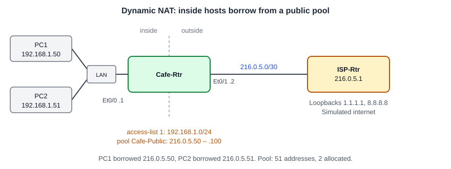

# Configuring Dynamic NAT: An Access List and a Public Address Pool

**Platform:** Cisco CML (IOS-XE 17.16 router image + Tiny Core Linux PCs), from the NetworkChuck Academy *Fall into CCNA* cohort, Skill 10 Lesson 05 lab. The lab ran in a browser emulator, so there is no `.pka` file. The commands and the captured output are in [configs/](configs/).

*Topology drawn from the lab brief and the running configuration; the cohort did not provide a diagram. The LAN box stands for whatever joins both PCs to Et0/0; the log does not show it.*

## What it configures

This follows on from [Configuring Static NAT](../static-nat-two-hosts/), on the same routers. The two one-to-one static mappings are removed and replaced with dynamic NAT: a standard access list says which inside addresses may be translated, a pool holds the public addresses to lend out, and one rule ties them together. Any host on the cafe LAN now borrows the next free public address when it sends traffic out.

| Item | Setting |
|---|---|
| Inside interface | Cafe-Rtr Et0/0, `192.168.1.1/24`, `ip nat inside` |
| Outside interface | Cafe-Rtr Et0/1, `216.0.5.2/30`, `ip nat outside` |
| Inside addresses | `access-list 1 permit 192.168.1.0 0.0.0.255` |
| Public pool | `Cafe-Public`, `216.0.5.50` to `216.0.5.100` (51 addresses) |
| Rule | `ip nat inside source list 1 pool Cafe-Public` |

## Skills demonstrated

- Removing static NAT entries with `no ip nat inside source static ...`
- A standard access list with a wildcard mask to match a whole /24
- `ip nat pool` with a start address, end address and netmask
- Binding the list to the pool with `ip nat inside source list ... pool ...`
- Reading `show ip nat translations` and `show ip nat statistics` for dynamic entries

## Verification

| Completion check | Result |
|---|---|
| Static entries are gone | ✅ `show ip nat translation` returned nothing after the two `no` commands, and the running config has no `static` lines |
| A dynamic rule references access list 1 and pool `Cafe-Public` | ✅ `ip nat inside source list 1 pool Cafe-Public` in the running config |
| The pool covers `216.0.5.50` to `216.0.5.100` | ✅ `ip nat pool Cafe-Public 216.0.5.50 216.0.5.100 netmask 255.255.255.0` |
| Hosts consume pool addresses while reaching `1.1.1.1` | ✅ PC1 and PC2 5 of 5 each. `192.168.1.50` borrowed `216.0.5.50` and `192.168.1.51` borrowed `216.0.5.51` |
| Pool use | ✅ `show ip nat statistics`: 2 dynamic translations, `total addresses 51, allocated 2 (3%), misses 0` |

**Not captured:** a `write memory`. The configuration was verified in the running config but the log does not show it being saved. Also not shown: ISP-Rtr's routes back to the pool range (the replies prove they exist; see note 3).

## Notes from the lab

1. **Two kinds of entries per host.** For each PC the translation table shows a simple entry (`--- 216.0.5.50  192.168.1.50`) that holds the address binding, and an `icmp` entry for the ping itself (`icmp 216.0.5.50:711  192.168.1.50:711  1.1.1.1:711`). Both PCs kept their own ICMP identifiers, `711` and `710`, because each host had a whole public address to itself.
2. **Dynamic NAT is still one-to-one.** Each inside host takes a full public address for as long as its binding lasts. The pool has 51 addresses, so a 52nd simultaneous host would get no translation; `misses 0` in the statistics shows that limit was never hit. Sharing one address across many hosts needs the `overload` keyword, which IOS offered in the `?` list after the pool name. That is port address translation (PAT), the next step.
3. **The ISP has to route the pool back.** The pool addresses are not on the /30 between the routers, so replies to `216.0.5.50` and `.51` only reach Cafe-Rtr because ISP-Rtr has routes for them. I didn't capture ISP-Rtr's table in this lab, but the 5-of-5 replies on both PCs show the return path worked.
4. **The pool mask is a range check, not an interface setting.** `netmask 255.255.255.0` only tells IOS that the start and end addresses belong to the same /24. It does not have to match the /30 on Et0/1.
5. **IOS-XE rewrites the numbered list.** I typed `access-list 1 permit 192.168.1.0 0.0.0.255`, but the running config shows it as `ip access-list standard 1` with sequence number `10`. Same list, newer display format.
6. **`show ip access list` returned nothing, without an error.** IOS appears to have read `list` as the name of an access list that doesn't exist, so the command was valid and the output was empty. `show ip access-lists` showed the real entry.
7. **A stray dot in the pool range.** I typed `2.16.0.5.100` (five octets) as the end address, which gave `% Unrecognized command` and then `% Invalid input`. The `$` at the start of those lines is IOS scrolling a long command, not part of what I typed.
8. **Building commands with `?`.** As in the static NAT lab, I stepped through `access-list ?`, `ip nat pool ?` and `ip nat inside source list 1 pool Cafe-Public ?` to find the syntax.
