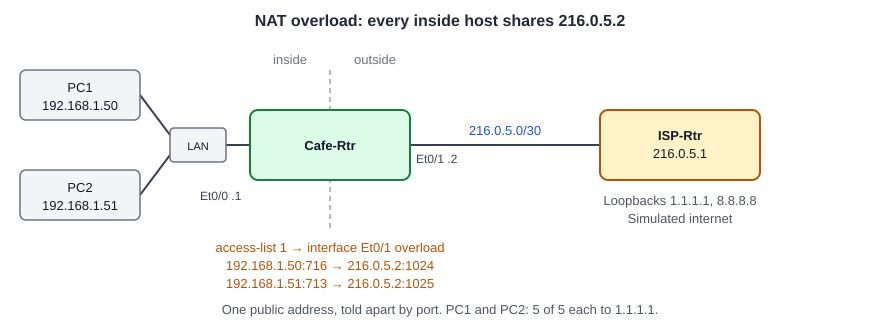

# Configuring NAT Overload (PAT): Every Cafe Host Behind One Address

**Platform:** Cisco CML (IOS-XE 17.16 router image + Tiny Core Linux PCs), from the NetworkChuck Academy *Fall into CCNA* cohort, Skill 10 Lesson 06 lab. The lab ran in a browser emulator, so there is no `.pka` file. The commands and the captured output are in [configs/](configs/).

*Topology drawn from the lab brief and the running configuration; the cohort did not provide a diagram. The LAN box stands for whatever joins both PCs to Et0/0; the log does not show it.*

## What it configures

The last step in the NAT series, after [static NAT](../static-nat-two-hosts/) and [dynamic NAT](../dynamic-nat-pool/). The dynamic pool rule is removed, and the same access list is pointed at the router's own WAN address with `overload`. Every inside host now shares `216.0.5.2`, and the router tells their sessions apart by port (for pings, by ICMP identifier). This is port address translation (PAT), the form of NAT almost every home and small-office router uses.

| Item | Setting |
|---|---|
| Inside interface | Cafe-Rtr Et0/0, `192.168.1.1/24`, `ip nat inside` |
| Outside interface | Cafe-Rtr Et0/1, `216.0.5.2/30`, `ip nat outside` |
| Inside addresses | `access-list 1 permit 192.168.1.0 0.0.0.255` (reused) |
| Removed | `ip nat inside source list 1 pool Cafe-Public` |
| Added | `ip nat inside source list 1 interface ethernet 0/1 overload` |

## Skills demonstrated

- Removing a dynamic NAT rule cleanly, with the interfaces shut so no translations are in use
- Interface-based PAT: `ip nat inside source list 1 interface <outside> overload`
- Reading extended translations: one public address, different ports per inside host
- Comparing `show ip nat statistics` before and after traffic

## Verification

| Completion check | Result |
|---|---|
| Pool rule removed and replaced with the overload rule | ✅ `show run` no longer has `list 1 pool Cafe-Public`; `show running-config \| include ip nat inside source` returns `ip nat inside source list 1 interface Ethernet0/1 overload` |
| Et0/0 inside, Et0/1 outside, links restored to up/up | ✅ `show running-config interface` shows `ip nat inside` and `ip nat outside`. Both lines logged up/up after `no shut` |
| Both hosts share `216.0.5.2` on different ports | ✅ `216.0.5.2:1024 ↔ 192.168.1.50:716` and `216.0.5.2:1025 ↔ 192.168.1.51:713` |
| Hosts reach `1.1.1.1` | ✅ PC1 and PC2 5 of 5 each, twice |
| Configuration saved | ✅ `wr` after the translations were captured |

## Notes from the lab

1. **The router rewrites the identifiers, not just the address.** PC1's ping used ICMP identifier `716` and PC2's used `713`. On the outside, both left as `216.0.5.2`, with identifiers `1024` and `1025`. With two hosts on one address, the identifier (or port, for TCP and UDP) is the only thing that tells the replies apart, so the router assigns its own. Compare the [dynamic NAT](../dynamic-nat-pool/) lab, where each host had its own public address and kept its original identifier.
2. **What changed in the statistics.** Before the pings: `0` active translations, `refcount 0`, `Hits: 20`. After: `2 (0 static, 2 dynamic; 2 extended)`, `refcount 2`, `Hits: 40`. "Extended" means address plus port, which is what overload creates.
3. **No pool, no extra public addresses, no extra ISP routes.** Static and dynamic NAT both needed addresses the ISP had to route back to the cafe. With overload on the interface, replies come back to `216.0.5.2`, which is already on the connected /30. The router also follows its interface address if the ISP ever changes it.
4. **Why shut the interfaces first.** Removing a dynamic NAT rule while translations are using it makes IOS stop and ask for confirmation. Shutting both interfaces first meant the table was empty, so `no ip nat inside source list 1 pool Cafe-Public` went through without a prompt.
5. **Translations expire quickly.** My first two `show ip nat translations` came back empty because no ping had run in the last minute. ICMP entries time out fast, so I captured the table with a 30-ping run still going.
6. **A configuration command at the `#` prompt.** My first `no ip nat inside source list 1 pool Cafe-Public` failed with `% Invalid input` because I ran it before `conf t`.
7. **Leftover pool.** `ip nat pool Cafe-Public 216.0.5.20 216.0.5.30 netmask 255.255.255.240` is still in the configuration. Nothing references it now, and the brief didn't ask for it to be removed.
8. **`over` was enough.** IOS accepted `overload` abbreviated to `over`, and the running config stores it in full.
9. **A filter typo fails silently.** `show running-config | include ip nat inside soource` returned nothing, with no error. `include` just searches for the text, so a misspelled pattern looks exactly like a missing line. Rerunning it spelled correctly showed the rule.
