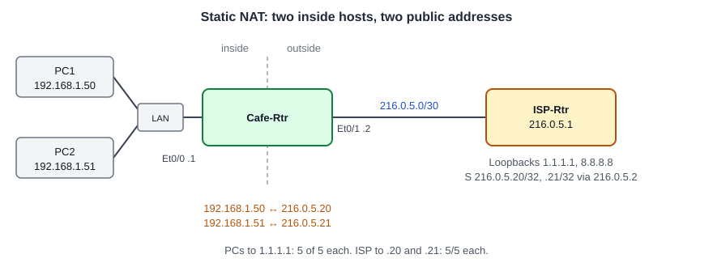

# Configuring Static NAT: Publishing Two Inside Hosts on Public Addresses

**Platform:** Cisco CML (IOS-XE router images + Tiny Core Linux PCs), from the NetworkChuck Academy *Fall into CCNA* cohort, Skill 10 Lesson 04 lab. The lab ran in a browser emulator, so there is no `.pka` file. The commands and the captured output are in [configs/](configs/).

*Topology drawn from the lab brief and the ISP routing table; the cohort did not provide a diagram. The LAN box stands for whatever joins both PCs to Et0/0; the log does not show it.*

## What it configures

The cafe LAN uses private addresses, and the ISP has no route back to them, so LAN hosts cannot reach the simulated internet even with a default route in place. Static NAT on the cafe router gives each of two hosts its own public address, one-to-one, in both directions.

| Device | Role | Address |
|---|---|---|
| Cafe-Rtr Et0/0 | LAN, `ip nat inside` | `192.168.1.1/24` |
| Cafe-Rtr Et0/1 | WAN to ISP, `ip nat outside` | `216.0.5.2/30` |
| ISP-Rtr Et0/0 | ISP edge | `216.0.5.1/30` |
| ISP-Rtr loopbacks | Simulated public services | `1.1.1.1`, `8.8.8.8` |
| PC1 | Inside host | `192.168.1.50` ↔ `216.0.5.20` |
| PC2 | Inside host | `192.168.1.51` ↔ `216.0.5.21` |

## Skills demonstrated

- Diagnosing a missing return path: default route out, but no route back to private space
- `ip nat inside source static <inside local> <inside global>`
- Marking the NAT boundary with `ip nat inside` and `ip nat outside`
- Reading `show ip nat translations`: inside local versus inside global
- Proving both directions: outbound from the hosts, inbound from the ISP

## Verification

| Completion check | Result |
|---|---|
| PC1 and PC2 get replies from `1.1.1.1` | ✅ PC1 5 of 5, PC2 5 of 5, 0% loss |
| Cafe-Rtr shows both static entries | ✅ `216.0.5.20 ↔ 192.168.1.50` and `216.0.5.21 ↔ 192.168.1.51` |
| ISP-Rtr pings the public addresses without loss | ✅ `216.0.5.20`: 5/5. `216.0.5.21`: 5/5 |
| Before NAT, PC1 could not reach the internet | ✅ `ping -c 5 1.1.1.1`: 100% packet loss |
| Configuration saved | ✅ `wr` after both mappings existed |

**Not captured:** the temporary ICMP translations the brief mentions. `show ip nat translations` was run when no traffic had passed recently, so only the two static entries appear. Also not captured: `show running-config interface` for the inside/outside markings, though the working pings in both directions depend on them.

## Notes from the lab

1. **Why the PCs failed before NAT.** PC1's first `ping -c 5 1.1.1.1` lost all 5. The request still left the cafe, because Cafe-Rtr has a default route to the ISP. The reply had nowhere to go: ISP-Rtr's routing table has connected routes, its loopbacks, and host routes for `216.0.5.20/32` and `216.0.5.21/32`, but nothing for `192.168.1.0/24`. Private addresses are never routed on the internet, so the fix is to stop sending them, not to add a route at the ISP.
2. **The ISP routes the leased addresses to the cafe.** `216.0.5.20` and `.21` are outside the /30 on the WAN link. ISP-Rtr reaches them through `S 216.0.5.20/32 [1/0] via 216.0.5.2`, which is how a provider hands a customer extra public addresses.
3. **Static NAT works both ways.** Each mapping is permanent, so the ISP can start a conversation with an inside host. `ping 216.0.5.20` and `ping 216.0.5.21` from ISP-Rtr both returned 5/5, reaching PC1 and PC2. That is what makes static NAT suitable for publishing a server; the PCs' own pings prove the outbound direction.
4. **The mapping exists before any traffic.** `show ip nat translations` listed `216.0.5.20 ↔ 192.168.1.50` immediately after the command, before any packet had crossed. Static entries are configuration, not learned state.
5. **I built the command with `?`.** I didn't remember the full syntax, so I stepped through `ip nat ?`, `ip nat inside ?`, `ip nat inside source ?` and `ip nat inside source static ?` until IOS showed `Inside local IP address` and then `Inside global IP address`. It's a quicker way to get the syntax than looking it up.
6. **Saved twice.** My first `wr` came after the PC1 mapping but before the PC2 one. The second `wr`, after both, is the one that captures the finished configuration.
7. **Syntax IOS rejected.** `int gi0/0` (this router has `Ethernet` ports), `show ip nat translation` from config mode (it needs `do`), and the typos `trasnlation` and `traslation`.
